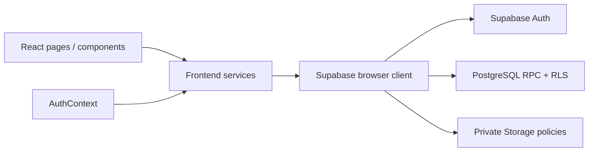

# Ranh giới frontend và backend

| Phần | Trách nhiệm | Không đặt tại đây |
| --- | --- | --- |
| `frontend/src/pages`, `components` | Hiển thị, form, loading/error, điều hướng | Query, SDK trực tiếp, secret key |
| `frontend/src/contexts` | Trạng thái phiên và hồ sơ cho React | Query trực tiếp |
| `frontend/src/services` | Đóng gói dữ liệu, Auth/Storage và xử lý lỗi | Quyền backend tin cậy |
| `frontend/src/integrations` | Khởi tạo SDK với cấu hình công khai | Secret/service-role key |
| `frontend/src/lib` | Hàm thuần và tiện ích trình duyệt | Query database |
| `backend/supabase` | Schema, RPC, RLS, nghiệp vụ, audit, Storage | JSX, CSS |

## Services

- `auth.service.ts`: phiên, callback PKCE/legacy, mật khẩu, email và TOTP.
- `profiles.service.ts`: hồ sơ, vai trò, mức xác thực và cập nhật hồ sơ.
- `clubs.service.ts`: CLB, minh chứng, nộp hồ sơ và lịch sử phiên bản.
- `admin.service.ts`: tra cứu, khóa/lưu trữ, đợt tuyển, xét duyệt và audit.
- `events.service.ts`: danh sách/chi tiết, đăng ký, quản lý và điểm danh.
- `request.ts`: xử lý kết quả RPC chung, chỉ các service nghiệp vụ sử dụng.

Di chuyển query sang service không biến chúng thành mã backend. Trình duyệt vẫn kết nối Supabase bằng publishable key và JWT của người dùng. RPC/RLS là nơi quyết định quyền cuối cùng; kiểm tra trên giao diện chỉ phục vụ trải nghiệm.

## Giữ tương thích

- Các lệnh npm chính vẫn chạy từ `main`, dùng một lockfile và npm workspaces.
- URL, base Pages, hash routes, tham số RPC, schema, policy và nội dung migration giữ nguyên.
- Giữ tài nguyên công khai, CSS, carousel và scroll motion hiện tại.
- Vite tiếp tục đọc `.env.local` ở gốc với prefix `VITE_`; secret key không vào bundle.
- Không thêm migration, không chạy DDL/DML, không đổi cấu hình Supabase.
- Nhánh refactor chưa push/merge. Workflow deploy vẫn chỉ theo dõi `main`.

## Kiểm tra

Từ `main`: `npm run typecheck`, `npm test`, `npm run build`, `npm run build:pages`.

Test kiến trúc chặn UI import SDK/database, frontend import backend/Node API và biến secret trong mã frontend. Test SQL chạy offline bằng PGlite. Trước khi tích hợp, cần UAT đăng nhập/callback/MFA, upload/hồ sơ, guest xem hoạt động, đăng ký/hủy và quản trị trên môi trường thử.
